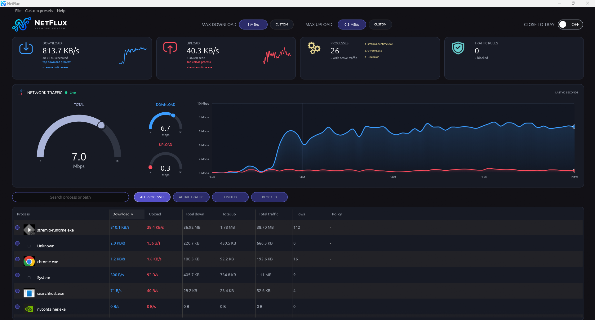
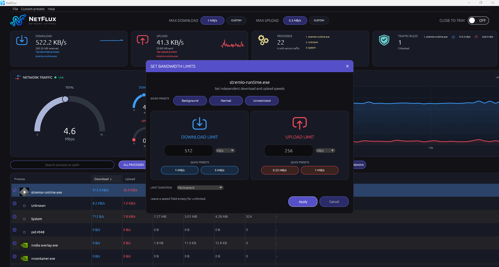

# NetFlux

**NetFlux is a source-available Windows network monitor and bandwidth controller.** It shows live network activity by process and gives you direct control over how much bandwidth each application can use — or how much bandwidth the entire computer can use.

Set separate download and upload limits, block an application's network traffic, apply temporary limits, manage reusable speed presets, or use a computer-wide ceiling to keep background traffic from consuming your connection.

The application is written in Rust and uses WinDivert 2.2.2 for packet interception and traffic shaping.

[Download NetFlux for Windows](https://github.com/Amel-Okicic/NetFlux/releases/latest)

## At a glance

### Main Dashboard

- Monitor live download and upload rates across running applications.
- See per-process traffic totals, active flow counts, and current network policies.
- Set independent download and upload limits for individual applications.
- Block or unblock an application's network traffic.
- Apply permanent or time-limited bandwidth rules.
- Select several applications and manage them together.
- Create, edit, and reuse paired download/upload presets.
- Set independent maximum download and upload rates for the whole computer.
- Keep NetFlux running in the system tray while its window is hidden.
- Save rules and interface preferences across restarts.

[Download NetFlux for Windows](https://github.com/Amel-Okicic/NetFlux/releases/latest)

## Feature guide

### 1. Live network dashboard

The dashboard brings the main network controls and live statistics together.

**Download and upload cards**
- Show the current total download and upload rates.
- Show cumulative data received and sent since NetFlux was started.
- Display the most active application in each direction.
- Include a short rate-history sparkline for each direction.
- Clicking a listed top application opens its process actions.

**Process overview**
- Shows the number of processes currently tracked.
- Shows how many currently have active network traffic.
- Provides a quick route to the active process list.

**Traffic rules overview**
- Shows the number of configured rules and blocked processes.
- Summarizes computer-wide limits and individual application rules.
- Provides a scrollable list so configured rules remain accessible even when there are many.
- Includes an action to remove the computer-wide limits.

**Network traffic panel**
- Displays total, download, and upload activity.
- Includes a live chart covering the most recent 60 seconds.
- Uses separate download and upload colors.
- Shows rate values when inspecting chart points.

<!-- Screenshot placeholder: dashboard overview and summary cards -->

### 2. Per-process network monitoring

NetFlux tracks network activity by executable and displays it in a sortable process table.

The table can show:

| Column | What it shows |
|---|---|
| Process | Application name and executable icon |
| Download | Current download rate |
| Upload | Current upload rate |
| Total down | Data received since NetFlux started |
| Total up | Data sent since NetFlux started |
| Total traffic | Combined received and sent totals |
| Flows | Number of active network flows attributed to the application |
| Policy | Current limits, blocked state, and temporary-rule countdown |

Additional behavior:
- Rates and process statistics are refreshed continuously, with backend snapshots produced about once per second.
- Multiple running instances that use the same executable path are grouped under one application entry.
- Rules are associated with the executable's full path, not just its displayed filename.
- Application icons are extracted from executable files when available.
- The table can be resized and its columns can be rearranged by dragging the column headers.
- The selected sort column and direction are saved between sessions.

You can sort by process name, current download rate, current upload rate, total download, total upload, combined total traffic, or active flow count. Click a sortable column again to reverse the sort direction.

Holding **Ctrl** temporarily freezes the process-row ordering while live traffic measurements continue updating. This is useful when rapidly changing rates would otherwise move rows around while you are inspecting or selecting applications.

<!-- Screenshot placeholder: process table with live rates and policy column -->

### 3. Process search and filters

Find the application you need without manually scanning the entire process list.

- **Search:** matches an executable name or its full path.
- **All processes:** displays every tracked process.
- **Active traffic:** shows processes currently sending or receiving data.
- **Limited:** shows processes with a configured traffic rule.
- **Blocked:** shows processes whose traffic is blocked.

The search field and selected filter are remembered when the application is restarted.

<!-- Screenshot placeholder: process search and filter toolbar -->

### 4. Individual application controls

Right-click a process row to open its process actions. From there, you can manage that application's network policy.

**Independent download and upload limits**

Set either direction independently:
- Limit downloads without changing uploads.
- Limit uploads without changing downloads.
- Set both limits together.
- Leave either field empty to make that direction unlimited.

The rate editor supports:
- B/s
- KB/s
- MB/s
- GB/s

Values use base-1024 conversions. The editor accepts non-negative numeric rates, including decimal values. A zero rate stops traffic in that direction.

**Block and unblock**

- **Block process** drops the application's captured network traffic.
- **Unblock process** removes the block state while preserving any other configured limits.
- **Remove rule** deletes the saved policy for that executable.

Blocking and bandwidth limiting are separate controls: an application can have a speed limit without being blocked.

**Temporary limits**

A bandwidth rule can be permanent or expire automatically:
- Permanent
- 30 minutes
- 1 hour
- 2 hours
- Custom duration in hours and minutes

When a temporary rule expires, NetFlux restores the application's previous permanent rule. If there was no previous rule, the temporary rule is removed.

The remaining time is shown in the Policy column. Temporary-rule expiry is stored with the rule, so NetFlux can also process overdue rules after a restart.

<!-- Screenshot placeholder: individual process actions -->
<!-- Screenshot placeholder: bandwidth limit dialog and temporary duration selector -->

### 5. Bulk process management

NetFlux can apply actions to multiple selected applications instead of requiring each rule to be changed individually.

**Selection methods**
- Select rows using their checkboxes.
- Use Ctrl-click to add or remove individual rows from the selection.
- Use Shift-click to select a range of rows.
- Select all processes currently visible under the active search and filter.
- Deselect to clear the current selection.

**Bulk actions**
- **Limits:** set download and upload limits for the selected applications.
- **Block:** block the selected applications.
- **Unblock:** remove blocking from the selected applications.
- **Remove:** delete the selected applications' rules.

Actions that cannot apply to the current selection are disabled. The bulk limit dialog can preserve each application's existing temporary duration while changing its speeds.

<!-- Screenshot placeholder: multi-selection and bulk action toolbar -->

### 6. Built-in and custom bandwidth presets

Presets make frequently used speed combinations quick to apply.

**Built-in paired presets**

| Preset | Download | Upload |
|---|---:|---:|
| Background | 0.5 MB/s | 0.05 MB/s |
| Normal | 5 MB/s | 1 MB/s |
| Unrestricted | Unlimited | Unlimited |

**Quick per-direction values**

The individual limit dialog also provides quick values:
- Download: 1 MB/s and 5 MB/s.
- Upload: 0.25 MB/s and 1 MB/s.

**Custom presets**

Open **Custom presets → Manage presets** to:
- Add a preset with a name.
- Set its paired download and upload rates.
- Edit an existing preset.
- Delete presets you no longer need.
- Leave either rate empty to save that direction as Unlimited.

Saved presets appear in the bandwidth-limit dialog and can be applied to a process or a selected group of processes. Presets are saved locally and remain available after restarting NetFlux.

A preset represents a reusable pair of bandwidth values. It is not a complete application profile and does not store a separate set of rules for multiple programs.

<!-- Screenshot placeholder: custom preset manager -->
<!-- Screenshot placeholder: saved presets inside the bandwidth limit dialog -->

### 7. Computer-wide bandwidth limits

In addition to per-process rules, NetFlux can enforce an independent maximum download rate and maximum upload rate for the entire computer.

**Quick controls in the header**
- The download toggle applies or removes a 1 MB/s computer-wide download ceiling.
- The upload toggle applies or removes a 0.3 MB/s computer-wide upload ceiling.
- The active value is displayed on the corresponding control.
- Each direction can be controlled independently.

**Custom global limits**

Use **Custom** to enter a different maximum for either direction. The editor supports B/s, KB/s, MB/s, and GB/s. Leave a field empty for Unlimited.

Global limits are separate from application rules. They provide an overall ceiling even when individual processes have no configured limit. NetFlux schedules traffic across active processes so one process does not simply consume the entire shared allowance.

Global limits are saved separately and restored when NetFlux starts again. They can be removed using the header controls or the Unlimit action in the Traffic Rules card.

<!-- Screenshot placeholder: global download and upload controls -->
<!-- Screenshot placeholder: custom global bandwidth dialog -->

### 8. System tray and application preferences

**Close to tray**
- Enable **Close to tray** to hide the main window instead of shutting NetFlux down.
- The monitoring and traffic-control backend keeps running while the window is hidden.
- Click the NetFlux tray icon to restore the window.
- Disable the option when you want closing the window to exit the application normally.

The tray preference is saved between sessions.

**Remembered interface settings**

NetFlux saves:
- Selected process-table sort column and direction.
- Process-table column order.
- Search text and active process filter.
- Close-to-tray preference.
- Custom preset definitions.

**File and help menus**

The File menu provides shortcuts to:
- Open the rules file.
- Open the settings file.
- Open the application log.
- Open the NetFlux data folder.
- Exit the application.

The Help menu provides project documentation, issue reporting, release information, licensing details, and the About dialog.

NetFlux also prevents a second instance from running at the same time. This avoids two packet-shaping engines competing to capture and process the same traffic.

<!-- Screenshot placeholder: system tray behavior and application menu -->

### 9. Traffic handling and process attribution

NetFlux uses WinDivert 2.2.2 to capture and reinject network packets. The application does not install a separate NetFlux kernel driver.

The backend combines:
- WinDivert flow events.
- Windows TCP and UDP socket-table information.
- Process executable-path resolution.
- Packet parsing and per-process traffic accounting.
- Token-bucket rate shaping and packet queues.

The network packet parser handles IPv4 and IPv6 traffic. Loopback traffic is intentionally excluded.

**Special process entries**

- **Unknown:** represents traffic that could not be attributed to a specific executable. It can be monitored, but an individual process rule cannot be meaningfully applied to it.
- **System:** represents kernel-owned traffic. It can be managed, but it may include more than ordinary application traffic.

The System entry can include VPN tunnels, network shares, and Windows Update traffic. Applying a limit or block to System can therefore affect those services as well.

**VPNs and local proxy software**

Some VPN or web-filtering products route application connections through a local proxy. In that situation, the proxy process — rather than the original browser or application — owns the internet-facing connection. NetFlux will attribute and limit the traffic under that proxy process. Apply the rule to the proxy when that is where the traffic is being handled.

Because loopback traffic is excluded, this does not mean NetFlux blocks the local proxy's internal interception path.

## Download and installation

NetFlux currently targets **Windows 10/11, 64-bit**.

A runnable package needs these files together:
- netflux.exe
- WinDivert.dll
- WinDivert64.sys

Do not download only the executable. The WinDivert runtime files are required and are included in the packaged Windows build.

**Current build artifacts**

Until a versioned release is published, you can build the application through GitHub Actions:

1. Open the repository's **Actions** tab.
2. Select **Build Windows executable**.
3. Run the workflow on the main branch, or open a successful run.
4. Download the **NetFlux-Windows-x64** artifact.
5. Extract the package and run netflux.exe.

The workflow artifact is retained for 14 days. See [GITHUB_ACTIONS_BUILD.md](GITHUB_ACTIONS_BUILD.md) for the complete build instructions.

**Versioned releases**

The release workflow is configured to build and publish a Windows x64 ZIP when a version tag beginning with v is pushed. The package includes the executable, WinDivert runtime files, applicable license documents, and a SHA-256 checksum file.

## Administrator permissions and troubleshooting

**Administrator permission is required.** NetFlux needs elevation to open the WinDivert device. Its Windows manifest requests Administrator privileges, so Windows displays a UAC prompt when the application starts.

If the backend cannot start — for example, because the application was not elevated or a WinDivert file is missing — NetFlux displays an error window rather than silently closing.

**Antivirus detection**

WinDivert is a legitimate, signed packet-diversion driver. Some antivirus products may flag it heuristically because packet-diversion drivers are also used by certain network utilities and, in some cases, by malware. The bundled files are from the WinDivert 2.2.2 distribution. Verify files against the official [WinDivert project](https://reqrypt.org/windivert.html) before deciding whether to allow them.

**Application log**

Release builds write diagnostic information to:

%APPDATA%\NetFlux\netflux.log

The rules and preferences are stored in the same NetFlux data folder:
- rules.json — per-process rules and temporary-rule metadata.
- global_limits.json — computer-wide download and upload ceilings.
- settings.json — interface preferences and saved preset definitions.
- presets.json — paired preset data retained for compatibility with older NetFlux builds.

## Building from source

Requirements:
- Windows x64.
- A recent stable Rust toolchain (Rust 2024 edition).
- The WinDivert files included under the vendor directory.

From the repository root:

    cargo build --release

The build configuration links against the vendored WinDivert import library and embeds the Windows Administrator manifest. For manual execution of a locally built binary, place WinDivert.dll and WinDivert64.sys beside netflux.exe.

GitHub Actions also runs formatting, Clippy, tests, and Windows release compilation as part of the release workflow.

## Licensing

NetFlux is **source-available** and uses multiple licenses. The license depends on the origin of the specific code or contribution.

- **Original Throttle v0.1.2 code by [Francesco Gruosso](https://github.com/FrancescoCoding):** MIT License. See [LICENSE-MIT-THROTTLE](LICENSE-MIT-THROTTLE).
- **Original NetFlux contributions by [Amel Okicic](https://github.com/Amel-Okicic):** PolyForm Noncommercial License 1.0.0. See [LICENSE-NETFLUX-NONCOMMERCIAL.md](LICENSE-NETFLUX-NONCOMMERCIAL.md).
- **WinDivert:** separate third-party license. See [the vendored WinDivert license](vendor/WinDivert-2.2.2-A/LICENSE).
- **License scope and mixed files:** see [LICENSES.md](LICENSES.md).

The original Throttle portions remain under MIT. Amel's covered NetFlux contributions are noncommercial unless separate commercial permission is obtained. The PolyForm terms do not convert the entire project to MIT, and the MIT terms do not grant commercial rights to PolyForm-covered contributions.

[Download NetFlux for Windows](https://github.com/Amel-Okicic/NetFlux/releases/latest)

## Credits

- Copyright © 2026 Amel Okicic
- Based on Throttle v0.1.2 by [Francesco Gruosso](https://github.com/FrancescoCoding)
- Packet driver: WinDivert 2.2.2

[

